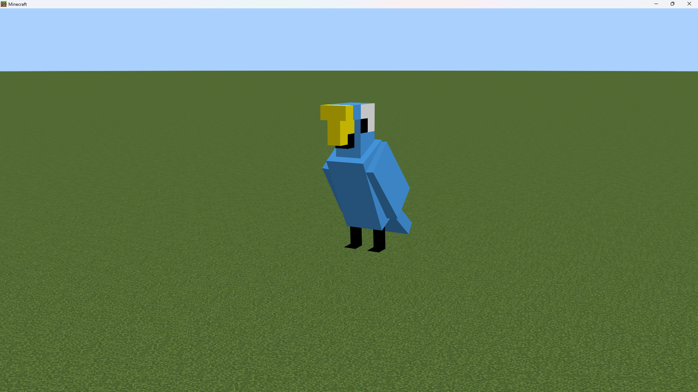

# Ligis-Bird

Minecraft Bedrock Edition 用のリソースパックです。

このテクスチャパックはリギスという人のイメージキャラクターをオウムにしたテクスチャとなります。

リギスくんのXアカウント: https://x.com/freegis718



## インストール

1. [Releases](https://github.com/MomokaSada/Ligis-Bird/releases) から `Ligis-Bird.mcpack` をダウンロード
2. ダブルクリックで Minecraft にインポート

## 使い方

### 対応バージョン

- Minecraft Bedrock Edition 1.16.0 以上（manifest の min_engine_version に準拠）

### 有効化

1. `Ligis-Bird.mcpack` をダウンロードする
2. ファイルをダブルクリックし、Minecraft にインポートする
3. Minecraft を起動し、設定 → グローバルリソース またはワールド設定 → リソースパック から「Ligis-Bird」を有効化する

### 効果

- オウム（インコ）の見た目が変更されます

### 注意事項

- リソースパックのため、サーバー側の設定や他のパックとの競合で表示が変わる場合があります
- 見た目のみの変更で、挙動は変更されません

## リリースの作り方

`v1.0.0` のようなタグを push すると、GitHub Actions が `resource_pack/` を zip して `.mcpack` を生成し、Release に添付します。

```bash
git tag v1.0.0
git push origin v1.0.0
```